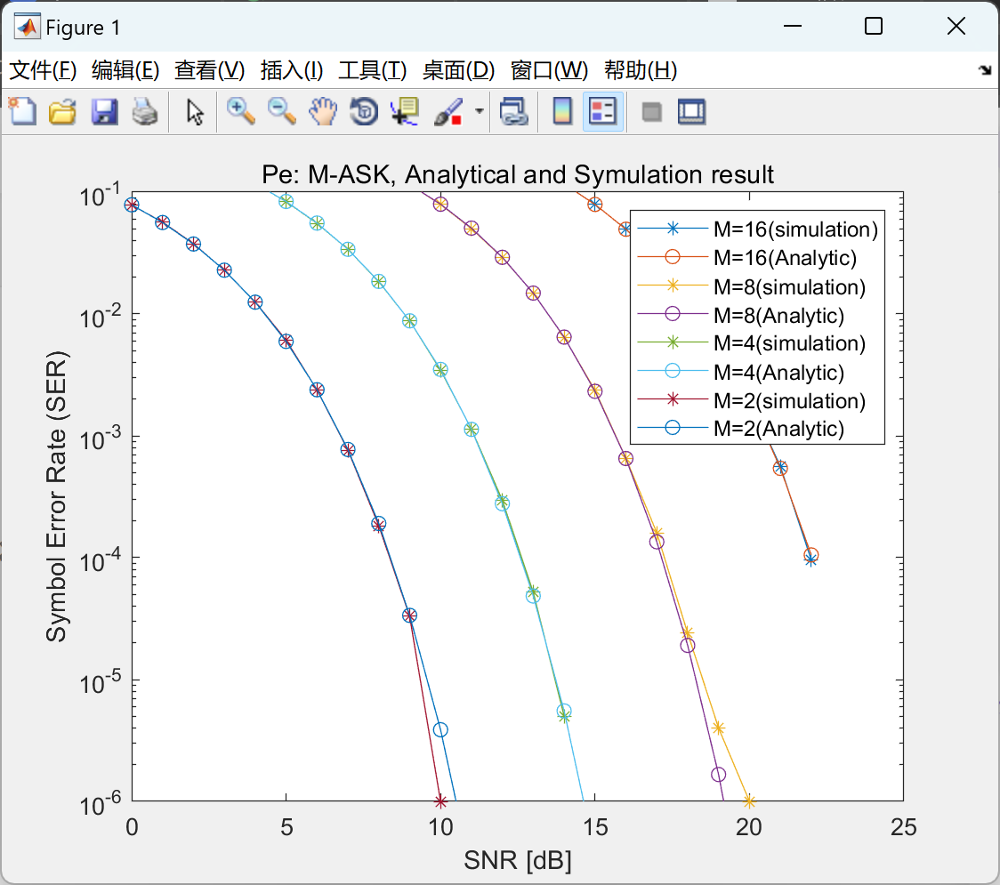

# M-ASK modulation error rate, obtain the M-ASK modulation error rate when M=2, 4, 8, 16, and compare the simulation and analysis results (Matlab code implementation)

The bit error rate of M-ASK modulation, obtain the bit error rate of M=2, 4, 8, 16 when M-ASK modulation, and compare the simulation and analysis results (Matlab code implementation).

## Images

<!-- PAYMENT_BLOCK -->

## Get this dataset

- Payment link (Stripe): [Buy now](https://buy.stripe.com/3cs8yP7sY87d0vu9AB)
- Payment QR code: 

<!-- /PAYMENT_BLOCK -->
